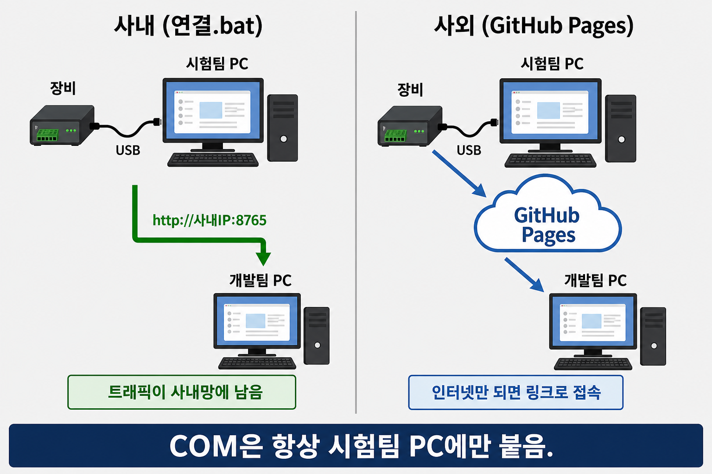
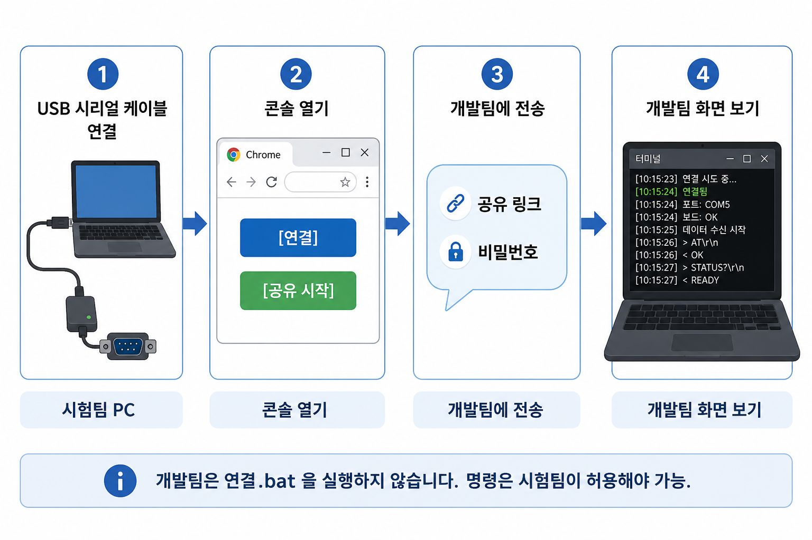
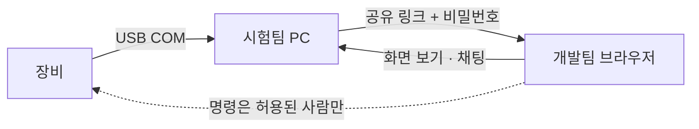

# 웹 시리얼 콘솔

Chrome / Edge 에서 장비 COM 을 여는 Tera Term 스타일 화면입니다.

**COM 은 항상 시험팀 PC 에만 붙습니다.** 개발팀은 링크만 받아 같은 화면을 봅니다.

공식 주소: [https://zero8711.github.io/mcr-web-console/](https://zero8711.github.io/mcr-web-console/)

브라우저: **Chrome 또는 Edge**. Firefox, Safari, `file://` 는 안 됩니다.

---

## 어디에 쓰나요

| 장소 | 시험팀 | 개발팀 |
|------|--------|--------|
| **사내** | `mcr_console.bat` 실행 → `http://127.0.0.1:8765/` | 시험팀이 준 **사내 IP:8765** 링크 |
| **사외 / 출장** | 위 공식 주소에서 [공유 시작] | 시험팀이 준 **GitHub 공유 링크** |

사내에서도 GitHub 링크만 쓸 수는 있습니다. 다만 회사망이 P2P 를 막으면 접속이 실패하거나, 콘솔 내용이 사외 중계를 탈 수 있습니다. 사내 로그를 망 안에 두려면 `mcr_console.bat` 을 쓰세요.

---

## 누가 무엇을 하나요

- 시험팀: 케이블이 꽂힌 PC. COM 연결, 공유, 이상로그 감시, 명령 허용.
- 개발팀: `mcr_console.bat` 을 실행하지 않습니다. COM 도 고르지 않습니다. 받은 링크만 엽니다.

---

## 기능

한 화면에서 COM 콘솔을 열고, 이상로그를 감시하고, 개발팀과 같은 화면을 공유합니다.

### 콘솔 화면

| 항목 | 내용 |
|------|------|
| 여러 대 | [콘솔 추가] / [콘솔 빼기]. **한 화면 최대 4칸.** 칸마다 COM 을 따로 연결합니다. |
| 선택 | 칸을 클릭한 뒤 [연결] · 명령 · 이상로그 대상이 그 칸으로 갑니다. |
| 이름 | 칸 위 이름을 바꾸면 공유 화면에도 그대로 보입니다. |
| 표시 | 검은 배경, 스크롤백 5000줄. 받기 처리는 Tera Term `CRReceive=LF` 와 같습니다. (`LF` 만 다음 줄, `CR` 은 그 줄 맨 앞) |
| 찾기 | 칸의 [찾기] 또는 **Ctrl+F**. Enter / F3 다음, Shift+Enter / Shift+F3 이전, Esc 닫기. |
| 지우기 | 선택한 칸 화면만 지웁니다. COM 연결과 로그 파일은 그대로입니다. |

공유 링크는 **1개**입니다. 시험팀이 칸을 늘리면 개발팀 화면에도 같은 칸이 생깁니다.

### 시리얼

| 항목 | 내용 |
|------|------|
| 연결 | [연결] → 장비 COM 선택. Tera Term 이 같은 COM 을 잡고 있으면 먼저 종료하세요. |
| 기본값 | Baud **115200**, Data 8, Parity none, Stop 1, 개행 **CR**, Local Echo 꺼짐. |
| 바꿀 수 있는 값 | Baud 9600~230400, Data 7/8, Parity none/even/odd, Stop 1/2, 개행 CR / LF / CR+LF. |
| 제어 신호 | 열 때 DTR / RTS 를 켭니다. (Tera Term 기본과 같게) |
| 한글 | 장비로 나가는 입력(키보드, 명령 칸, 빠른 명령)에서 한글은 빠집니다. 채팅은 그대로입니다. |

장비가 반응하지 않으면 개행을 LF 또는 CR+LF 로 바꿔 보세요.

### 명령

| 항목 | 내용 |
|------|------|
| 빠른 명령 | 버튼을 누르면 선택한 칸으로 나갑니다. 처음에는 `ifconfig`, `logread`, `reboot` 등이 들어 있습니다. |
| 버튼 추가 | 명령 칸에 넣고 [버튼 추가]. **최대 20개.** 이미 있는 명령은 다시 넣지 않습니다. |
| 편집 | [편집] 에서 삭제, [기본값] 으로 처음 목록을 되돌립니다. 버튼을 모두 지운 상태도 그대로 남습니다. |
| 저장 | 이 **브라우저에만** 남습니다. 다음에 같은 Chrome/Edge 로 열면 마지막 목록이 복구됩니다. |
| 명령 기록 | 오른쪽 [명령 기록] 에 누가 무엇을 보냈는지 남습니다. 채팅과는 별개입니다. |

개발팀은 시험팀이 [접속자 명령 허용] 에서 켠 사람만 장비를 칠 수 있습니다. 허용 전에는 화면 보기와 채팅만 됩니다.

### 로그

두 가지가 있습니다. **이상로그 감시**와 **세션 로그**는 서로 다른 파일입니다.

**이상로그 감시** (시험팀만 켬)

1. 칸을 고르고 [저장 파일] 또는 [저장 폴더] 로 위치를 정합니다.
2. 키워드를 넣고 [이상로그 감시] 를 켭니다. 예: `error, fail, panic`.
3. 맞으면 **위 200줄 · 아래 200줄**을 파일로 저장하고, 팝업 · 횟수 · 마지막 시각이 쌓입니다.
4. 개발팀 화면에도 목록과 팝업이 보입니다. 브라우저 알림을 허용하면 시험팀 PC 에도 뜹니다.
5. 키워드 · 횟수는 칸별로 이 브라우저에 남습니다. [횟수 지우기] 로 횟수만 지울 수 있습니다.

페이지를 닫으면 감시가 멈춥니다. 수집을 끝내려면 [수집 중단] 을 누르세요.

**세션 로그** (칸마다 [로그 저장] / [중지])

- Tera Term 식 세션 로그. 저장을 누른 시점부터 들어온 줄에 시각을 붙여 `.log` 로 남깁니다.
- 시험팀 · 개발팀 모두 자기 PC 에 저장할 수 있습니다.

### 원격 공유

| 항목 | 내용 |
|------|------|
| 시작 | 이름 + 공유 비밀번호 → [공유 시작]. 비밀번호: 영문 + 숫자 + 특수문자, **8자 이상**. |
| 링크 | [링크 복사] 한 주소와 비밀번호를 같이 보냅니다. 링크만으로는 방에 못 들어갑니다. |
| 인원 | 한 링크로 여러 명. **최대 20명.** 이름이 겹치면 나중에 들어온 사람은 이름2 로 표시됩니다. |
| 명령 허용 | [접속자 명령 허용] 에서 사람마다 켭니다. 기본은 채팅만. |
| 종료 | [공유 종료]. 탭이나 `mcr_console.bat` 창을 닫아도 끊깁니다. |
| 비밀번호 실패 | 5번 틀리면 **그 브라우저만** 1분 동안 다시 넣을 수 없습니다. 다른 사람·시험팀은 그대로입니다. |

사내(`mcr_console.bat`)는 시험팀 PC 의 TCP **8765** 로 화면을 중계합니다. 사외(GitHub Pages)는 브라우저 WebRTC 입니다.

### 채팅

- 장비로 나가지 않습니다. 사람과 사람만 봅니다.
- 저장된 `.log` 를 채팅창에 끌어다 놓으면 상대가 [다운로드] 로 받습니다. **약 450KB 이하.**
- 공유가 켜진 뒤에만 파일을 놓을 수 있습니다.

### 이 브라우저에 남는 것

같은 PC · 같은 브라우저로 다시 열면 아래가 복구됩니다. 다른 PC, 다른 브라우저, 시크릿 창에는 없습니다.

- 빠른 명령 버튼 목록
- 시험팀 이름, 공유기 사내 IP
- 개발팀 이름
- 칸별 이상로그 키워드 · 발생 횟수

공유 비밀번호와 COM 선택은 저장하지 않습니다.

---

## 시험팀

### 사내 배포

시험팀 PC에는 저장소 전체가 아니라 **`office-dist` 폴더만** 통째로 복사하면 됩니다. `mcr_console.bat` 만 빼서 주면 실행되지 않습니다. 개발팀 PC에는 이 폴더가 필요 없습니다.

소스나 화면을 바꾼 뒤에는 `pack-office.bat` 을 실행해 `office-dist` 를 다시 채웁니다.

### 사내 (`mcr_console.bat`)

1. `mcr_console.bat` 을 실행합니다. **검은 창은 닫지 마세요.**
2. Chrome 이 `http://127.0.0.1:8765/` 로 열립니다. **이 주소에서만** COM 을 연결하세요.
3. [연결] → 장비 COM 을 고릅니다. Tera Term 이 같은 COM 을 잡고 있으면 먼저 종료하세요.
4. 장비가 여러 대면 [콘솔 추가] 후 칸을 클릭하고 다시 [연결] 합니다. 최대 4대, 공유 링크는 1개입니다.
5. 이름과 공유 비밀번호를 넣고 [공유 시작] 합니다.  
   비밀번호: 영문 + 숫자 + 특수문자, 8자 이상.
6. [링크 복사] 한 주소와 비밀번호를 개발팀에 보냅니다. 링크만으로는 방에 못 들어갑니다.
7. 끝나면 [공유 종료]. 탭이나 `mcr_console.bat` 창을 닫아도 공유가 끊깁니다.

다른 PC 에서 페이지 자체가 안 열리면 시험팀 PC 방화벽에서 TCP **8765** 인바운드를 허용하세요. `mcr_console.bat` 을 **관리자로 한 번** 실행하면 규칙을 넣으려고 합니다.

시험팀이 ipTIME 뒤에 있고 개발팀이 그 LAN 이 아니면:

- `mcr_console.bat` 이 UPnP 로 TCP 8765 포워드를 시도합니다. 검은 창에 `UPnP: WAN ...` 이 나오면 그 주소가 공유 링크 맨 위에 들어갑니다.
- **같은 공유기 Wi-Fi/유선** PC 는 노트북 IP(`192.168.…`) 링크를 쓰세요. UPnP WAN 주소는 안에서 안 열리는 경우가 많습니다.
- UPnP 가 실패하면 [공유기 사내 IP] 에 **공유기가 사내망에서 받은 주소**를 적고, 공유기에서 TCP 8765 를 이 PC 로 포워드하세요. 노트북 IP 가 아닙니다.
- 출장 / LTE 는 UPnP 로도 안 열립니다. 양쪽 VPN 을 쓰거나 아래 사외 방법을 쓰세요.
- `mcr_console.bat` 창을 닫으면 UPnP 매핑 해제를 시도합니다.

### 사외 (GitHub Pages)

1. [https://zero8711.github.io/mcr-web-console/](https://zero8711.github.io/mcr-web-console/) 를 엽니다.
2. [연결] 로 COM 을 연 뒤, 이름·비밀번호 → [공유 시작].
3. 나온 공유 링크와 비밀번호를 보냅니다. 개발팀은 `mcr_console.bat` 이 필요 없습니다.
4. **이 탭을 닫으면 공유가 끊깁니다.**

Custom domain / CNAME 은 넣지 마세요.

---

## 개발팀

1. `mcr_console.bat` 을 실행하지 않습니다.
2. 받은 링크를 Chrome / Edge 로 엽니다.
3. 이름과 **시험팀에게 받은 비밀번호**를 넣고 [접속] 합니다.
4. 처음에는 **화면 보기와 채팅만** 됩니다. 장비 명령은 시험팀이 [접속자 명령 허용] 에서 켠 사람만 가능합니다. 허용되면 상태줄이 `명령 가능` 으로 바뀝니다.
5. 이상로그가 뜨면 목록·팝업이 원격에도 보입니다. 시험팀이 채팅에 떨어뜨린 로그 파일은 [다운로드] 로 받습니다.
6. 칸의 [로그 저장] 으로 지금 보고 있는 화면을 자기 PC 에 남길 수 있습니다.

상태가 초록(공유 접속됨)이 될 때까지 기다리세요.

---

## 안 될 때

**공유 링크가 안 열림**

- 시험팀 탭과 (`mcr_console.bat` 을 썼다면) 검은 창이 아직 열려 있는지 확인합니다.
- 사내: 링크가 `http://사내IP:8765/...` 인지 봅니다. Pages `github.io` 링크는 사내 전용이 아닙니다.
- 같은 공유기 안: 노트북 IP 링크를 쓰세요. UPnP WAN 주소는 안에서 시간 초과가 나는 경우가 많습니다.
- 다른 자리 사내망: UPnP 또는 공유기 사내 IP + 포트포워드가 필요합니다.
- 사외: 회사망이 WebRTC 를 막으면 Pages 공유가 실패할 수 있습니다. 그때는 `mcr_console.bat` + VPN 을 씁니다.

**COM 이 안 열림**

- Chrome / Edge 의 `https://` 또는 `http://127.0.0.1` 인지 확인합니다.
- 같은 COM 을 Tera Term 이 잡고 있으면 종료합니다.

**비밀번호**

- 5번 틀리면 그 브라우저만 1분 동안 다시 넣을 수 없습니다. 다른 사람·시험팀은 그대로입니다.

---

## 관리자 참고

- 저장소를 Private 로 바꾸면 무료 계정에서는 Pages 가 내려갑니다. 다시 Public 으로 해도 Settings → Pages 에서 `main` / `/ (root)` 를 다시 켜야 합니다.
- 사내 IIS 에 `index.html`, `join.html`, `src/`, `vendor/` 만 올리면 COM 화면은 됩니다. 공유는 여전히 `mcr_console.bat` 입니다.
- 사내 배포는 `office-dist` 폴더를 통째로 복사합니다. 내용은 `pack-office.bat` 으로 다시 만듭니다.
- `mcr_console.bat` 의 C# 을 바꾼 뒤에는 창을 닫고 다시 실행하세요.
- 사용 폴더의 `README.txt` 는 시험팀 PC 용 짧은 안내입니다. 기능 설명은 이 파일을 보세요.
